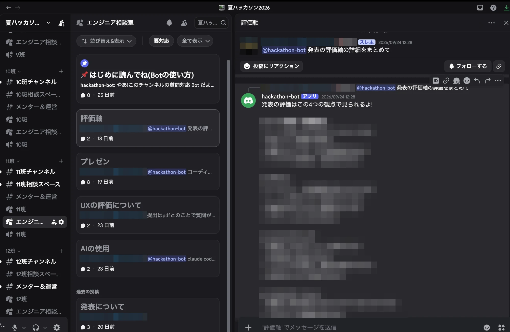
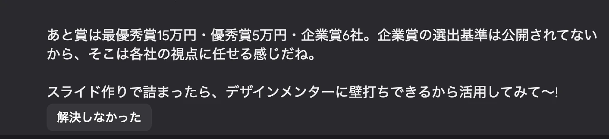
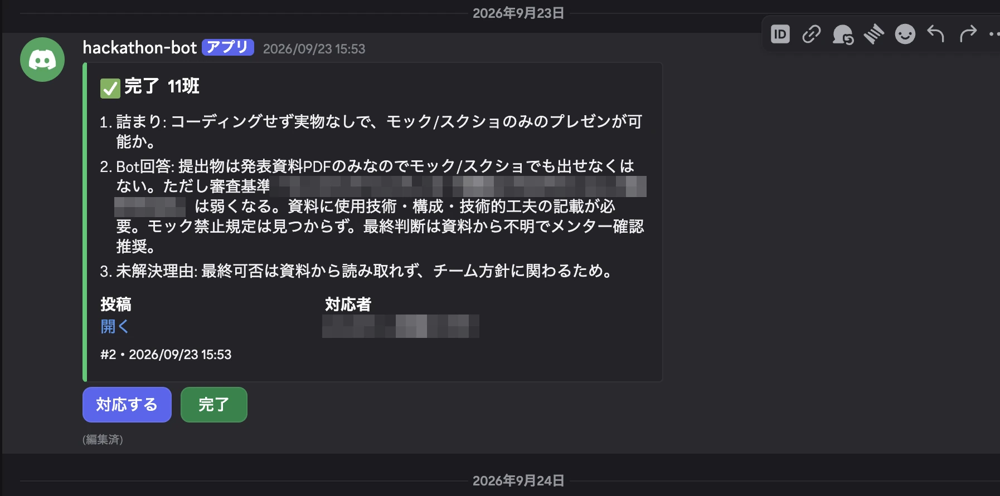
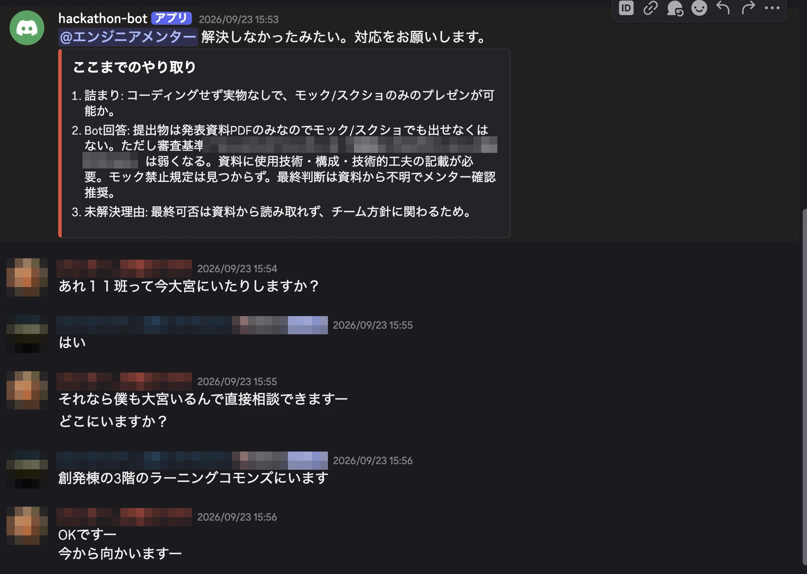
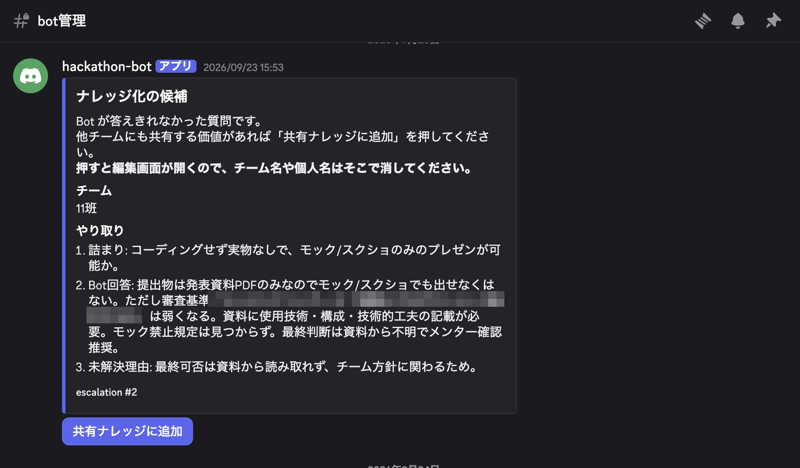

# hackathon-bot

初心者向けハッカソンで、参加者の質問に答え、解決しなければエンジニアメンターへ引き継ぐ Discord Bot。

## 概要

デザイナーとエンジニアの混成チームで参加する、初心者の多いハッカソン向けに作りました。
エンジニアメンターの数が参加者に比べて少ないため、よくある質問（環境構築・Git・スケジュールや提出方法など）は Bot が答え、
Bot で解決しないものだけをメンターに回して、メンターの負担を分散します。

参加者が普段から使っている Discord 上で動くので、質問のハードルが低く、回答はチームメンバーとメンターにも見えます。

**運用実績**: 2026年9月、22チーム規模の初心者向けハッカソンで運用しました。
今後は、サークル内で開催するハッカソンに向けて改善し、運用する予定です。

## 実際の画面

2026年9月のハッカソンで運用したときの画面です（参加者・メンターの名前と、イベント固有の審査基準はぼかしています）。

### 参加者側

**1. 相談室で Bot に質問する**

チームごとの「エンジニア相談室」フォーラムに質問ごとの投稿を立て、`@hackathon-bot` をメンションします。Bot は運営の知識源と環境構築 FAQ をもとに、その投稿の中で答えます。



**2. 解決しなければ、ボタンでメンターを呼ぶ**

Bot の回答の最後には「解決しなかった」ボタンが付きます。押すと人間のメンターに引き継がれます。



### メンター側

**3. 呼び出しを受け取る**

メンター用のチャンネルに、それまでのやり取りの要約と相談室へのリンクが届きます。「対応する」を押した1人が担当になり、終わったら「完了」を押します。



**4. 相談室で直接対応する**

相談室の投稿にも、要約付きでエンジニアメンター宛ての通知が出ます。メンターはリンクから入り、その投稿の中で参加者とやり取りします。



**5. 答えきれなかった質問を知識にする**

Bot が答えきれなかった質問は、ナレッジ化の候補として「Bot管理」チャンネルに届きます。他のチームにも役立つものは「共有ナレッジに追加」を押し、名前などを消してから Bot の知識に取り込みます。



### メンター側のチャンネル構成

| チャンネル | 役割 |
|---|---|
| エンジニアメンターキュー | 呼び出しの受付。要約と相談室へのリンクが届き、「対応する」「完了」で担当者と状態を管理する（30 分対応がなければ未対応に戻る） |
| Bot管理 | 共有ナレッジの管理。Bot の稼働状況と、使用量が閾値を超えたときのアラートもここに出る |

人手の足りないエンジニアメンター向けに作りましたが、メンターのロールと2つのチャンネルは名前ではなく ID（環境変数）で指定しています。設定を変えれば、デザインなど他の分野のメンター向けにも使えます。その場合は、Bot が答える内容（`prompts/system_prompt.md` と `knowledge/`）もその分野に合わせて差し替えます。

## 仕組み

```
参加者がチームの「エンジニア相談室」フォーラムに投稿し、@Bot をメンション
  │
  ▼
Bot が回答（Claude API）
  ・システムプロンプト ＋ 知識源（運営情報・環境構築 FAQ）
  ・同じ投稿スレッド内の会話履歴、添付画像・コードファイル
  │
  ├─ 解決した → 終了
  └─「解決しなかった」ボタン
        ▼
     メンター用チャンネルに要約付きで通知（エンジニアメンターのロールだけにメンション）
        ▼
     メンターが「対応する」→「完了」（30 分対応がなければ自動で未対応に戻る）
```

## 主な機能

- **質問への回答**: 運営が用意した知識源と環境構築 FAQ をもとに回答する。知識源にない運営事項は推測で答えない
- **メンターへの引き継ぎ**: 要約付きで通知し、「対応する」ボタンで担当者を1人に決める（同時に押しても1人しか成立しない）
- **知識の追加**: 開催中に変わる情報（締切の変更など）を、メンターがスラッシュコマンドで追加できる。良い Q&A は承認すると知識として取り込まれる
- **コストの管理**: チームごと・個人ごとのレート制限、プロンプトキャッシュ、使用量が閾値を超えたときのアラート
- **安全の確保**: 相談室フォーラムの外では LLM を呼ばない、他チームの会話を文脈に混ぜない、メンター以外のロールに通知を飛ばさない
- **運営の補助**: 22 チーム分のカテゴリ・フォーラム・権限を一括で作るスクリプト、設定を診断するコマンド、稼働状況の表示

## 技術構成

| 領域 | 技術 |
|---|---|
| 言語 | Python 3.13 |
| Discord | discord.py（スラッシュコマンド・永続ボタン・モーダル） |
| LLM | Anthropic SDK（Claude API）。`ANTHROPIC_BASE_URL` で Anthropic 互換の別サービス（DeepSeek など）にも切り替え可能 |
| DB | SQLite（aiosqlite）。引き継ぎの状態・追加した知識・質問ログ |
| ホスティング | Railway（常時起動のプロセス ＋ Volume で SQLite を永続化） |

仕様の詳細は [`SPEC.md`](SPEC.md)、運営側の準備は [`SETUP_CHECKLIST.md`](SETUP_CHECKLIST.md)、デプロイは [`DEPLOY.md`](DEPLOY.md) を参照。

> **知識源について**: `knowledge/` のうち、運営が用意する会場・日程・審査基準・規約（10〜40 番）は、イベント固有の非公開情報のためリポジトリに含めていません。環境構築 FAQ（50 番台）と AI 向けプロンプトの骨組み（60 番）は含まれています。

## セットアップ

```bash
python3 -m venv .venv
source .venv/bin/activate          # Windows: .venv\Scripts\activate
pip install -r requirements.txt

cp .env.example .env               # 値を埋める
```

`.env` に最低限必要なのは `DISCORD_TOKEN` の1つ。

**テスト用と本番で同じ Bot を使う場合は `GUILD_ID` を必ず設定すること。**
未設定だと参加している全サーバーで動作し、テストのエスカレーションが
本番のキューチャンネルへ飛ぶ。

対象フォーラムは既定でチャンネル名(`FORUM_CHANNEL_NAME=エンジニア相談室`)で探すため、
22 チーム分の ID を集める必要はない。
他の変数は未設定でも起動でき、起動時に「まだ設定されていない」旨が警告ログに出る。

## 本番サーバーの構築

```bash
python -m src.setup_server --from-categories          # 確認のみ
python -m src.setup_server --from-categories --apply  # 実行
```

既にある 22 チーム分のカテゴリの中にフォーラムとタグを作り、
メンター用のカテゴリ・チャンネル・ロールを用意する。
Bot とエンジニアメンターの閲覧権限が足りなければ、**足りない分だけ**追加する。

**既定は dry-run**で、`--apply` を付けたときだけ実行する。既にあるものは飛ばす。

## 設定の診断(起動前に実行する)

```bash
python -m src.check
```

Discord に接続して、対象フォーラムの件数・権限・タグ・チャンネル ID を点検して終了する。
**メッセージは一切送信しない。**22 チームへ展開するときは、本番サーバーでもこれを最初に流す。

## 起動

```bash
python -m src.bot
```

## テスト

```bash
python -m unittest discover -s tests
```

次の項目は事故に直結するため、テストで固定している。

- **動作範囲の限定** — 「エンジニア相談室」フォーラム内の投稿以外で LLM を呼ばない(22 チーム分を名前で解決)
- **チーム間の情報遮断** — 履歴の取得元を単一スレッドに限定する
- **プロンプトキャッシュ** — システムプロンプトに投稿ごとに変わる情報を混ぜない
- **メンション制御** — エンジニアメンター以外のロールに通知が飛ばない
- **排他制御** — 6 人が同時に「対応する」を押しても 1 人しか成立しない
- **30 分の自動解除** — 期限は DB に持ち、プロセス再起動をまたいでも失われない

## Bot が落ちたときの検知

`Bot管理` チャンネルに稼働状況のメッセージを 1 通置き、5 分ごとに「最終更新」を書き換える。
**表示が数分以上古くなっていれば Bot が落ちている。**

毎回新しく投稿せず 1 通を編集し続けるので、チャンネルは静かなまま。
通知が増えると、やがて誰も見なくなるため。

## 運営向けコマンド(エンジニアメンター限定)

| コマンド | 内容 |
|---|---|
| `/add-knowledge` | 知識を追加する。カテゴリを選ぶとモーダルが開く |
| `/list-knowledge` | 追加済みの知識を一覧する |
| `/remove-knowledge` | 追加した知識を無効化する(削除ではない) |
| `/stats` | 質問数・エスカレーション数・概算コストをチーム別に見る |
| `/post-guide` | 全チームの相談室に使い方の案内を一括投稿する(確認ボタンあり) |

知識を追加・削除するとシステムプロンプトが組み直され、プロンプトキャッシュは
一度無効になる。開催中に数回しか起きないので問題にならない。

## プロンプトキャッシュについて

知識源(約 38,000 字)は毎リクエスト送られるが、システムプロンプトは
**起動時に一度だけ組み立てて使い回す**ため、2回目以降はキャッシュから読まれる。

効いているかはログで確認できる:

```
LLM 使用量 model=claude-opus-5 input=32 cache_write=0 cache_read=14200 output=380
```

`cache_read` が常に 0 なら、システムプロンプトのどこかがリクエストごとに変わっている。
**会話履歴・チーム名・時刻などを `prompts/system_prompt.md` に書かないこと。**

## ディレクトリ

```
prompts/system_prompt.md   Bot に与えるシステムプロンプト本文
knowledge/                 知識源。全文がシステムプロンプトに埋め込まれる(10〜40 番はリポジトリ外)
src/
  bot.py                   エントリポイント
  config.py                環境変数の読み込みと検証
  messages.py              参加者向けの文言(トーン調整はここに集約)
  discord_utils.py         メッセージ分割など Discord 固有の処理
  scope.py                 動作範囲(相談室フォーラム)の判定
  attachments.py           画像・コードファイルの取り込みと上限
  ratelimit.py             レート制限(チーム毎時 / 個人の連投)
  usage.py                 質問ログ・コスト集計・使用量アラート
  knowledge/manager.py     システムプロンプトの保持と再構築
  knowledge/store.py       動的追加された知識と承認済み Q&A
  escalation/approval.py   ナレッジ化の承認フロー
  cogs/admin.py            運営向けスラッシュコマンド
  cogs/health.py           稼働状況の可視化(無言で死んだときの検知)
  guide.py                 初回案内の一括投稿
  setup_server.py          本番サーバーの構築(python -m src.setup_server)
  check.py                 設定の診断コマンド(python -m src.check)
  cogs/mention.py          @bot メンションの受け口
  knowledge/loader.py      knowledge/ の読み込み
  llm/prompt.py            システムプロンプトの構築(起動時に一度だけ)
  llm/client.py            Claude API(互換サービス含む)呼び出しとエラーの正規化
  llm/conversation.py      投稿内の履歴を messages[] に変換
  db/                      SQLite のスキーマと接続
  escalation/
    mentions.py            ★ロールメンションの安全制御(最重要)
    models.py              状態(未対応/対応中/完了)の定義
    store.py               永続化と排他制御
    summarizer.py          要約生成とフォールバック
    embeds.py              通知の組み立て(LLM生成文はここに入れる)
    views.py               永続ボタン
    service.py             一連の処理のまとめ役
  cogs/escalation.py       View の再登録と 30 分ポーリング
tests/                     回帰テスト
```

## Railway へのデプロイ

`Procfile` で `worker: python -m src.bot` を指定している。

⚠️ **Volume を必ずマウントし、`DB_PATH` をそのマウントポイント配下にすること。**
Volume の外に SQLite を置くと、再デプロイのたびにデータが消える。

## よくあるつまずき

### `ModuleNotFoundError: No module named 'discord'`

仮想環境を有効にしていない。ターミナルを開き直すたびに必要。

```bash
source .venv/bin/activate
```

プロンプトの先頭に `(.venv)` が付いていれば有効になっている。

### `SSLCertVerificationError: unable to get local issuer certificate`(macOS のみ)

python.org のインストーラで入れた Python には、CA 証明書のバンドルが同梱されていない。
コードの問題ではなく、Mac のローカル環境だけで起きる(Railway の Linux では起きない)。

**恒久的な修正**(1回だけ。以後すべての Python プロジェクトで解決する):

```bash
"/Applications/Python 3.13/Install Certificates.command"
```

**その場しのぎ**(`pip install certifi` が必要):

```bash
SSL_CERT_FILE=$(python -m certifi) python -m src.check
```

## Python バージョン

`.python-version` で 3.13 に固定している。ローカルと Railway で揃えること。
